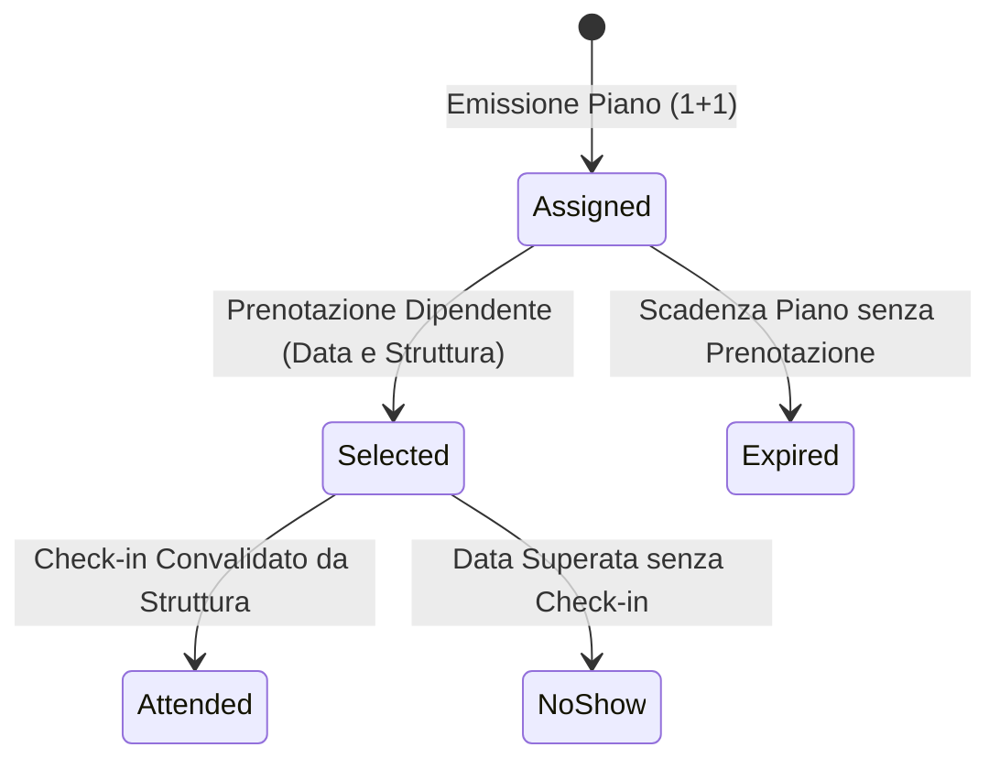

# RADICI — Guida Operativa alle Business Rules e ai Calcoli di Piattaforma

Questo documento formalizza la logica, le formule matematiche e i valori di dominio dell'ecosistema **RADICI** (*Welfare Territoriale Integrato*).  
Fornisce sia la specifica architetturale completa, sia il copy sintetico per le **«Note Esplicative»** (tooltip / box a scomparsa) da inserire nelle interfacce utente.

---

## 1. Architettura dei Voucher: La Regola Base "1 + 1"

### Concetto e Scopo
Ogni impresa cliente (CSR) sottoscrive un Piano Welfare annuale per i propri dipendenti eleggibili.  
Per legge (Art. 51 TUIR) e per contratto di rete, a ciascun addetto sono assegnati **esattamente 2 voucher welfare nominativi**:
1. **1 Voucher Pernottamento** (Valore nominale: **50,00 €**)
2. **1 Voucher Cena / Aperitivo KM 0** (Valore nominale: **25,00 €**)

### Formule e Metriche
* **Plafond Welfare Virtuale Annuo per Addetto**:  
  $$\text{Plafond Addetto} = 50{,}00\text{ €} + 25{,}00\text{ €} = 75{,}00\text{ €}$$
* **Plafond Virtuale Complessivo Azienda**:  
  $$\text{Plafond Stanziato} = N_{\text{addetti eleggibili}} \times 75{,}00\text{ €}$$
* **Voucher Emessi**:  
  $$\text{Totale Emessi} = N_{\text{addetti}} \times 2 \quad (N\text{ pernottamenti} + N\text{ cene})$$

### Modello Economico Pay-Per-Use (Addebito all'Atto della Scelta)
L'impresa sponsor **non versa l'intero importo a fondo perduto in anticipo**:
* All'emissione, il plafond è **virtuale**.
* L'obbligazione di pagamento verso il fornitore (**debito B2B certo**) matura **nel momento esatto in cui il dipendente seleziona la data e la struttura** (`status = 'selected'`).
* **Regola di tutela dei fornitori**: se l'addetto non si presenta alla data concordata (**No-show**), il fornitore emette comunque fattura all'impresa sponsor per l'intero importo nominale.

> 📝 **Testo per Nota Esplicativa UI:**  
> *"Ogni dipendente ha diritto a 1 pernottamento (50€) e 1 cena KM 0 (25€). L'addebito per l'impresa matura solo all'atto della prenotazione della struttura ed è irrevocabile a tutela dell'operatore locale, anche in caso di no-show."*

---

## 2. Il Funnel dei Voucher (Ciclo di Vita e Stati)

### Concetto
Il funnel monitora la transizione dei voucher emessi nel corso dell'anno. La somma degli stati restituisce sempre il totale dei voucher emessi.

### Relazione Matematica
$$\text{Totale Emessi} = \text{Ancora da selezionare} + \text{Selezionati} + \text{Convalidati} + \text{No-Show} + \text{Scaduti}$$

| Stato Tecnico | Etichetta UI | Descrizione Operativa |
| :--- | :--- | :--- |
| `assigned` | **Ancora da selezionare** | Il voucher è nel portafoglio dell'addetto ma non è ancora stato vincolato a una struttura. |
| `selected` | **Selezionati (addebito maturato)** | L'addetto ha scelto struttura e data. Il debito B2B è registrato e il fornitore riceve il prospetto di fattura. |
| `attended` | **Presenza convalidata** | L'ospite si è presentato e la struttura ha registrato il check-in tramite scansione QR o conferma manuale. |
| `no_show` | **No-show (addebito resta)** | L'ospite non si è presentato. La struttura incassa comunque il credito dall'azienda sponsor. |
| `expired` | **Scaduto** | Il piano annuale è terminato e il voucher non è stato prenotato entro i termini. |

### Esempio Pratico del Database Demo (5 addetti)
* Emessi: $5 \text{ pernottamenti} + 5 \text{ cene} = 10\text{ voucher}$
* Selezionati: $3\text{ voucher}$ (Mario notte, Anna notte, Luca cena)
* Ancora da selezionare: $10 - 3 = 7\text{ voucher}$ (Mario cena, Giulia notte, Giulia cena, Luca notte, Anna cena, Sofia notte, Sofia cena).

> 📝 **Testo per Nota Esplicativa UI:**  
> *"Il funnel traccia l'avanzamento dei voucher: 'Ancora da selezionare' rappresenta i voucher in mano ai dipendenti non ancora spesi; 'Selezionati' sono i voucher già impegnati su una data che costituiscono addebito contrattuale per l'impresa."*

---

## 3. La Regola Extra sui Residui (Premialità al 20%)

### Concetto e Scopo
A ridosso della conclusione del piano welfare (es. ultimi 30 giorni), molti voucher rischiano di scadere inutilizzati. La piattaforma attiva una finestra di riassegnazione automatica per premiare i dipendenti più attivi ed evitare la dispersione del capitale sul territorio.

### Condizioni Matematiche di Eleggibilità (R5)
La regola opera in modo **indipendente per tipologia** (Pernottamenti vs Cene):
1. **Finestra Temporale**:  
   $$\text{Giorni alla scadenza} \le \text{extra\_window\_days (default: 30)}$$
2. **Soglia di Attivazione (20% residuo)**:  
   $$\text{Voucher Residui Inutilizzati} \ge 20\% \text{ dei Voucher Base della stessa tipologia}$$
3. **Plafond Massimo Extra Assegnabile (Cap 20%)**:  
   $$\text{Max Extra Disponibili} = \lfloor \text{Voucher Base} \times 20\% \rfloor$$
4. **Beneficiari**:  
   Possono richiedere un voucher extra **esclusivamente gli addetti che hanno già utilizzato entrambi i propri voucher base** ($1 \text{ notte} + 1 \text{ cena}$).

> 📝 **Testo per Nota Esplicativa UI:**  
> *"Negli ultimi 30 giorni del piano, se oltre il 20% dei voucher base di una tipologia risulta inutilizzato, una quota fino al 20% dei residui viene sbloccata come premio extra per chi ha già completato il proprio piano 1+1."*

---

## 4. Matching Grant Culturale (Teatri Storici delle Marche)

### Concetto
Per ogni voucher Pernottamento fruito, la **Startup RADICI (con i Promotori)** finanzia a proprie spese un **Matching Grant culturale** per assistere a uno spettacolo di prosa nei Teatri Storici della rete.
* **Costo per l'azienda CSR**: **0,00 €** (il costo è totalmente coperto dal gestore piattaforma).
* **Opzioni di Fruizione**:
  * **1 Persona** (solo dipendente): valore nominale **25,00 €** (1 posto)
  * **2 Persone** (dipendente + accompagnatore): valore nominale **50,00 €** (2 posti da 25,00 €)

### Protocollo Anti-Spreco (Finestra di Conferma T-7 / T-3)
1. **T-7 giorni dallo spettacolo**: il dipendente riceve notifica ed email per confermare l'effettiva partecipazione dei posti prenotati.
2. **T-3 giorni dallo spettacolo**: termine ultimo per confermare. Se il dipendente non risponde entro T-3, i posti tornano automaticamente disponibili per altri utenti per non lasciare poltrone vuote a teatro.

> 📝 **Testo per Nota Esplicativa UI:**  
> *"Per ogni pernottamento welfare, RADICI finanzia fino a 2 biglietti a teatro (50€) a costo zero per l'azienda sponsor. Per non sprecare posti in platea, la presenza va riconfermata tra 7 e 3 giorni prima dell'evento."*

---

## 5. Ripartizione Economica, Commissioni e Netto Fornitori

### Modello di Sostenibilità della Piattaforma

| Tipologia Prestazione | Valore Nominale | Fee Piattaforma RADICI | Netto Liquidato al Fornitore |
| :--- | :--- | :--- | :--- |
| **Pernottamento Welfare** | 50,00 € | **10%** (5,00 €) | **45,00 €** |
| **Cena / Aperitivo KM 0** | 25,00 € | **10%** (2,50 €) | **22,50 €** |
| **Matching Grant Teatro** | 25,00 € / posto | **0%** (Contributo RADICI) | **25,00 € / posto** (al Teatro) |
| **Cesti Produttori Agricoli KM 0** | Prezzo catalogo | **0%** (Sostegno filiera) | **100% del prezzo scontato** |

### Flusso di Fatturazione Fiscale
1. La struttura erogatrice riceve la notifica con i dati fiscali dell'impresa (Ragione Sociale e P.IVA).
2. La struttura emette fattura B2B direttamente all'impresa con dicitura:  
   *«Prestazione Welfare Aziendale ex Art. 51 TUIR»*.
3. La piattaforma RADICI fattura separatamente alla struttura convenzionata la commissione del 10% per il servizio tecnologico e di promozione.

> 📝 **Testo per Nota Esplicativa UI:**  
> *"La piattaforma trattiene una fee del 10% sulle prestazioni ricettive per la gestione del circuito, mentre azzera le commissioni sui teatri storici e sui produttori agricoli per favorire l'economia dei piccoli borghi."*

---

## 6. Filiera Produttori KM 0: Sinergie Flotta, CO₂ e Regola 10:1

### 1. La Business Rule 10:1 (Cesto in Omaggio agli Addetti)
I dipendenti e la loro rete di amici possono acquistare cesti agroalimentari tipici direttamente dai piccoli produttori:
* **Meccanismo**: per ogni **10 cesti complessivamente acquistati** presso un produttore convenzionato dalla rete collegata a un'impresa CSR, il produttore riconosce **1 cesto omaggio gratuito** consegnato presso la sede aziendale.

### 2. Logistica a Km Zero e Calcolo CO₂ Evitata
La consegna dei cesti avviene aggregata sfruttando le **sinergie di flotta aziendale già attive sul territorio** (es. furgoni delle consegne ordinarie), azzerando le corse dedicate a vuoto:
* **Chilometri individuali di tragitto evitati**: convenzione SSOT di **50 km** risparmiati per ogni cesto rispetto a viaggi singoli in auto.
* **Fattore di Emissione Veicolare**: **0,265 kg CO₂ / km** (furgone diesel / media flotta mista).
* **Formula Risparmio Ambientale**:  
  $$\text{CO}_2\text{ Evitata per Cesto} = 50\text{ km} \times 0{,}265\text{ kg CO}_2/\text{km} = 13{,}25\text{ kg CO}_2$$

> 📝 **Testo per Nota Esplicativa UI:**  
> *"Ogni 10 cesti acquistati da dipendenti o amici scatta 1 cesto omaggio in azienda. La logistica aggregata risparmia 50 km di viaggi singoli a cesto, evitando 13,25 kg di emissioni di CO₂."*

---

## 7. Il Moltiplicatore di Impatto Territoriale (5,1x)

### Concetto
Il welfare aziendale territoriale genera un impatto economico moltiplicato rispetto ai buoni spesa tradizionali (che disperdono il capitale verso grandi catene multinazionali).

### Metodologia di Calcolo ESG
Dalle analisi di impatto econometrico sui borghi e sull'indotto locale (accompagnatori, ristorazione extra, acquisti tipici in loco, prolungamento soggiorni):
$$\text{Valore Territoriale Complessivo} = \text{Capitale Welfare Finanziato} \times 5{,}1$$

* **Esempio**: Un piano welfare aziendale da **32.000 €** genera oltre **163.200 €** di spesa diretta e indotta che rimane interamente nei comuni delle Aree Interne e delle comunità ospitanti.

> 📝 **Testo per Nota Esplicativa UI:**  
> *"Ogni euro di welfare convertito nel circuito attiva una spesa indotta certificata di 5,10€ nei borghi e nelle filiere locali, attraverso i consumi di accompagnatori e soggiorni prolungati."*

---

## 8. Riepilogo Matrice Componenti UI per le Note Esplicative

| Sezione Dashboard / Pagina | Titolo Nota | Parametri Chiave Spiegati |
| :--- | :--- | :--- |
| **Azienda CSR (`/azienda`)** | Quadro Plafond e Addebiti | Plafond 75€/addetto, modello pay-per-use, debito irrevocabile alla prenotazione |
| **Azienda CSR (`/azienda`)** | Sinergie Flotta & Cesti KM 0 | Attribuzione ordini addetti + amici, 50 km evitati, 13,25 kg CO₂/cesto |
| **Promotori (`/promotori`)** | Funnel Voucher | Relazione 10 emessi = 7 da selezionare + 3 selezionati |
| **Promotori (`/promotori`)** | Regola Extra 20% | Finestra ultimi 30 giorni, soglia 20% residuo, cap 20%, solo per addetti virtuosi |
| **Promotori (`/promotori`)** | Matching Grant Teatri | Contributo 100% RADICI (25€/50€), finestra di riconferma T-7 / T-3 |
| **Fornitore (`/fornitore`)** | Compensi e Liquidazione | 90% netto struttura ricettiva, 10% commissione piattaforma, fatturazione ex Art. 51 TUIR |
| **Pagina Imprese (`/imprese`)** | Rating ESG e Moltiplicatore 5,1x | Misurazione impatto borghi, filiera fresca, formula moltiplicatore 5,1x |
