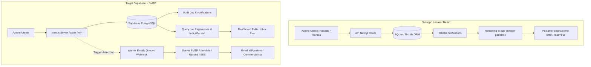

# Architettura di Produzione: Notifiche SMTP, Supabase & Gestione Fiscale B2B Scalabile

> **Documento Tecnico di Riferimento per il Rilascio in Produzione**  
> **Progetto:** RADICI — Piattaforma di Welfare Aziendale Territoriale & Coesione  
> **File:** `Doc/open_architecture_SMTP.md`  
> **Data:** Novembre 2026  

---

## 1. Obiettivo del Documento

Questo documento definisce l'architettura tecnica e le linee guida per la messa in produzione della piattaforma RADICI con **Supabase (PostgreSQL)** e un provider di **notifiche email transazionali (SMTP / API)**.  

Fornisce la risposta ingegneristica a due esigenze fondamentali:
1. **Integrazione SMTP & Email Transazionali:** Come trasformare le attuali notifiche in-app in comunicazioni email automatiche (ad es. notifica di riscatto voucher per emissione fattura, notifica di revoca/annullamento) senza bloccare le prestazioni web.
2. **Scalabilità UX & Database ("Inbox Zero"):** Come tracciare migliaia di operazioni e mantenere la piena conformità fiscale decennale (Art. 51 TUIR, D.P.R. 633/72) **senza intasare le pagine web dei fornitori** con elenchi chilometrici di righe e card.

---

## 2. Stato Attuale vs Target di Produzione



---

## 3. Specifiche di Integrazione Notifiche SMTP

### 3.1 Variabili d'Ambiente (`.env.production`)
Nel file di configurazione di produzione del deployment (Cloud Run, Vercel o VPS) vanno predisposte le seguenti variabili:

```bash
# === CONFIGURAZIONE SMTP AZIENDALE ===
SMTP_HOST=smtp.tuodominio.it
SMTP_PORT=587
SMTP_SECURE=false # true per porta 465 SSL, false per 587 STARTTLS
SMTP_USER=notifiche@radici.it
SMTP_PASS=SuperSecretPassword123!
SMTP_FROM="RADICI Welfare Territoriale <notifiche@radici.it>"

# === ALTERNATIVA: API TRANSAZIONALI (Raccomandate per alta deliverability) ===
# RESEND_API_KEY=re_123456789
# POSTMARK_SERVER_TOKEN=pm_123456789
```

### 3.2 Modulo Adapter Email (`src/lib/email.ts`)
Predisposizione del servizio asincrono disaccoppiato:

```typescript
import nodemailer from "nodemailer";

const transporter = nodemailer.createTransport({
  host: process.env.SMTP_HOST,
  port: Number(process.env.SMTP_PORT) || 587,
  secure: process.env.SMTP_SECURE === "true",
  auth: {
    user: process.env.SMTP_USER,
    pass: process.env.SMTP_PASS,
  },
});

interface SendEmailParams {
  to: string;
  subject: string;
  html: string;
  text?: string;
}

export async function sendEmail({ to, subject, html, text }: SendEmailParams) {
  if (!process.env.SMTP_HOST) {
    console.warn("[EMAIL MOCK] SMTP non configurato. Email non inviata a:", to);
    return;
  }
  return transporter.sendMail({
    from: process.env.SMTP_FROM,
    to,
    subject,
    html,
    text: text || html.replace(/<[^>]*>?/gm, ""),
  });
}
```

### 3.3 Eventi Fiscale/Operativi da Notificare via Email
1. **Riscatto Voucher Welfare (Nuova Prestazione da Fatturare):**
   - **Destinatario:** Email del Fornitore / Riferimento Amministrazione.
   - **Contenuto:** Dati fiscali impresa CSR committente (P.IVA, Ragione Sociale, Codice SDI, PEC), nome ospite lavoratore, importo convenzionato da fatturare (50,00 € o 25,00 €), scadenza, riferimento Art. 51 TUIR.
2. **Annullamento/Revoca Voucher da parte del Dipendente:**
   - **Destinatario:** Fornitore convenzionato.
   - **Oggetto:** `[ANNULLAMENTO] Voucher Revocato - Nessuna fattura da emettere`.
   - **Contenuto:** Avviso chiaro che il lavoratore ha cancellato la prenotazione prima della fruizione: la transazione è decaduta, nessun addebito e nessuna fattura elettronica richiesta.
3. **Ricezione Estremi Fattura & Conferma Saldo:**
   - Conferma automatica all'impresa committente con gli estremi della fattura emessa dal fornitore.

> [!IMPORTANT]
> **Asincronia Obbligatoria:** L'invio dell'email deve avvenire all'interno di un blocco non bloccante (`void sendEmail(...).catch(...)` oppure tramite coda di background job come BullMQ, QStash o Supabase Database Webhooks) per non rallentare l'esperienza utente su web.

---

## 4. Architettura UX per Evitare l'Affollamento di Dati ("Inbox Zero")

Quando una piattaforma cresce da 10 a 10.000 transazioni, visualizzare tutto in un'unica schermata rende la pagina inutilizzabile. La soluzione si basa su **4 pilastri**:

### 4.1 Pattern "Inbox Zero" sulle Notifiche
- **Dashboard Operativa Attiva:** Mostra unicamente le notifiche **non ancora prese in carico** (`read = false` e `archived_at IS NULL`).
- **Azione "Prendi in carico":**
  1. Il fornitore clicca su *"Prendi in carico / Segna come letta"*.
  2. Il sistema esegue `UPDATE notifications SET read = true, archived_at = NOW() WHERE id = :id`.
  3. L'elemento scompare immediatamente dalla vista attiva, mantenendo l'interfaccia pulita e priva di rumore visivo.
- **Badge Contatore:** Un semplice indicatore `🔔 Notifiche da evadere (2)` avvisa l'utente solo se ci sono azioni pendenti.

### 4.2 Paginazione Lato Server (Server-Side Pagination)
Invece di scaricare l'intero database nel browser del client:
- **Limite di Caricamento:** Visualizzazione a pagine di **10, 25 o 50 record** per volta.
- **Parametri URL:** `/fornitore?tab=welfare&page=1&limit=25&filter=active`.
- **Query SQL Ottimizzata:**
  ```sql
  SELECT t.*, u.first_name, u.last_name, c.name AS company_name
  FROM transactions t
  JOIN users u ON t.user_id = u.id
  LEFT JOIN companies c ON t.company_id = c.id
  WHERE t.venue_id = $1
  ORDER BY t.created_at DESC
  LIMIT 25 OFFSET $2;
  ```

### 4.3 Filtri Temporali Contabili (Mese / Anno / Trimestre)
Nel lavoro amministrativo reale, alberghi e ristoratori gestiscono le fatture per **competenza mensile**:
- Selettore a tendina rapido: `Mese Corrente (Nov 2026)`, `Mese Scorso (Ott 2026)`, `Trimestre Q4`, `Tutto l'Anno`.
- Filtro rapido di stato:
  - **Da Fatturare** (transazioni attive senza `invoice_number`)
  - **In Attesa di Saldo** (`payment_status = 'pending'`)
  - **Saldate** (`payment_status = 'settled'`)
  - **Revocate / Annullate** (`status = 'cancelled'`)

### 4.4 Cassetto Dettaglio a Scomparsa ("Slide-Over Drawer")
Per evitare che ogni riga della tabella occupi 200px di altezza con istruzioni fiscali, PEC e codici SDI:
- La **tabella principale** rimane ultracompatta a riga singola:
  `Data | Ospite | Committente | Importo Lordo | Presenza | N° Fattura | Stato Pagamento`
- Cliccando su una riga si apre un **cassetto laterale destro (Slide-over panel)** contenente:
  - Istruzioni complete di fatturazione B2B (Codice Destinatario SDI, PEC, Partita IVA).
  - Storico cronologico dell'evento (Data riscatto, data conferma presenza, data ricezione bonifico).
  - Note interne dell'amministrazione.

---

## 5. Modello Dati e Ottimizzazione Supabase (PostgreSQL)

### 5.1 Conservazione Fiscale Decennale (Audit Log Immutabile)
Per legge italiana (D.P.R. 633/72 art. 22 e 39), le registrazioni contabili e i giustificativi fiscali devono essere conservati per **10 anni**. Nessun record fiscale deve mai essere eliminato fisicamente (`HARD DELETE`).

In Supabase / PostgreSQL si applica:
1. **Soft Delete / Archiviazione:**
   ```sql
   ALTER TABLE notifications ADD COLUMN archived_at TIMESTAMP WITH TIME ZONE NULL;
   ALTER TABLE transactions ADD COLUMN archived_at TIMESTAMP WITH TIME ZONE NULL;
   ```
2. **Indici Parziali (Partial Indexes):**
   Garantiscono prestazioni istantanee alla dashboard filtrando solo i record attivi senza scorrere milioni di righe storiche archiviate:
   ```sql
   -- Indice ultraveloce per le notifiche non lette del fornitore
   CREATE INDEX idx_notifications_unread 
   ON notifications (venue_id) 
   WHERE read = FALSE AND archived_at IS NULL;

   -- Indice per le transazioni attive in attesa di fatturazione
   CREATE INDEX idx_transactions_pending_invoicing 
   ON transactions (venue_id) 
   WHERE invoice_number IS NULL AND status != 'cancelled';
   ```

### 5.2 Esportazione per il Commercialista (CSV / Excel)
Per evitare che il fornitore debba copiare a mano i dati o consultare schermate infinite:
- Endpoint dedicato: `GET /api/provider/export?format=csv&month=2026-11`
- Genera in 1 secondo un file CSV pronto per il gestionale o per il commercialista:
  `Data,ID_Voucher,Dipendente,Ragione_Sociale_Committente,Partita_IVA,Codice_SDI,Importo_Lordo,Quota_Welfare,Compenso_Netto,Stato_Presenza,N_Fattura_Emessa`

---

## 6. Checklist di Rilascio in Produzione

- [ ] Configurare le variabili d'ambiente SMTP / Resend in Supabase / Cloud Run.
- [ ] Verificare che le credenziali mittente (`FROM`) abbiano SPF, DKIM e DMARC configurati sul dominio DNS per evitare lo spam.
- [ ] Applicare le migrazioni Drizzle / Supabase con i campi `archived_at` e gli indici parziali.
- [ ] Impostare il timeout di visualizzazione notifiche: archiviare automaticamente in archivio storico le notifiche lette più vecchie di 30 giorni.
- [ ] Testare l'invio asincrono delle email durante il riscatto e l'annullamento dei voucher.
- [ ] Attivare l'endpoint di esportazione CSV mensile per la distinta fornitori.
