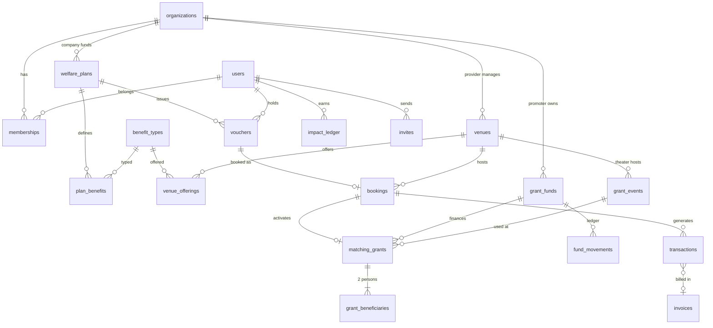
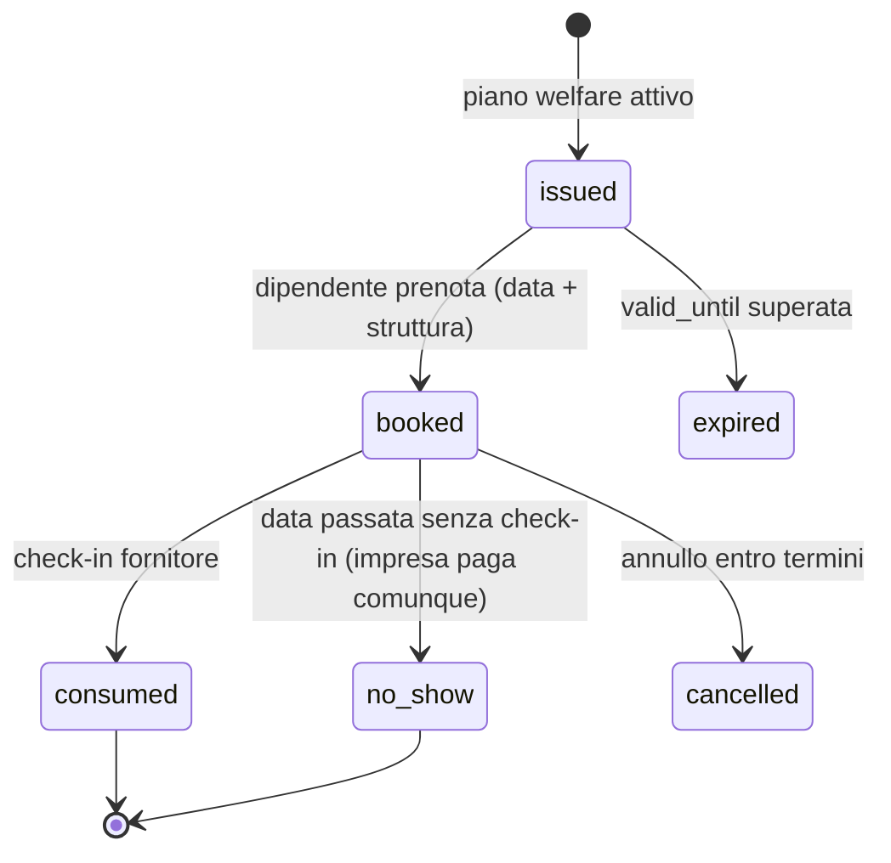
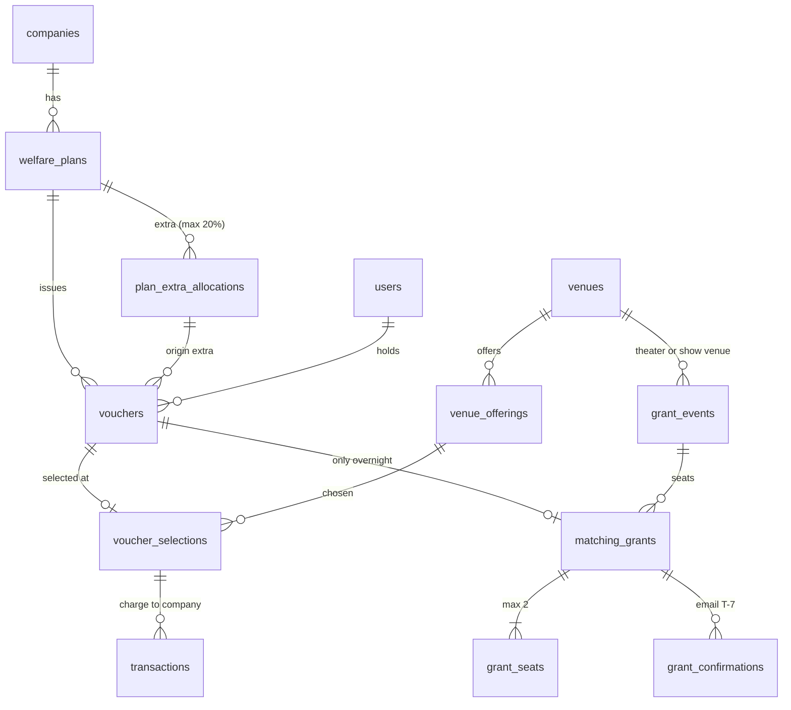
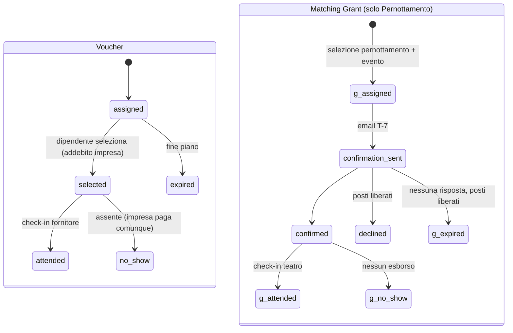

# RADICI — Revisione Tecnica: Schema Dati, Database e Funzionalità Hard-coded

> Data revisione: 29/10/2026 · Ambito: `src/db/*`, `src/lib/*`, `src/app/api/*`, componenti principali, documentazione in `Doc/` e `README.md`.
> Obiettivo: evidenziare le lacune del modello dati rispetto alle funzionalità dichiarate, le logiche fissate nel codice e non generalizzabili, e proporre un modello target con un piano di migrazione.

---

## 0. Sintesi esecutiva

| Area | Giudizio | Problema principale |
| :--- | :---: | :--- |
| Schema dati | 🔴 | Mancano entità di dominio fondamentali: **piano welfare / plafond**, **organizzazione promotrice e fondo**, **prenotazione** (data soggiorno, check-in, no-show), **matching grant** come oggetto proprio, **fatture**. |
| Coerenza DDL ↔ Drizzle | 🔴 | La tabella reale è creata da SQL a mano in `src/db/index.ts`, diverso da `schema.ts` (vincoli, default, nullabilità). `drizzle-kit` non è mai usato. |
| Integrità transazionale | 🔴 | Il riscatto voucher non è atomico: doppio riscatto possibile, scritture parziali. |
| Sicurezza | 🔴 | `POST /api/vouchers/reset-demo` **senza autenticazione** azzera il DB per tutti. Password SHA-256 con salt statico. |
| Logiche hard-coded | 🟠 | Fondo promotori 50.000 €, grant 50 €, voucher 50/25 €, 2 voucher a dipendente, fallback a 100 dipendenti, KPI ESG statici, certificati solo da seed. |
| Documentazione | 🟠 | I tre documenti in `Doc/` e il README descrivono stati superati (voucher `theater`, sezione "manca il cruscotto promotori", check-in "sospeso" pur esistendo `/checkin/[code]`). |

---

## 1. Errori e incoerenze dello schema attuale

### 1.1 Doppia definizione dello schema (DDL manuale vs Drizzle)

Lo schema esiste due volte: [schema.ts](file:///c:/Users/user/Desktop/radici/src/db/schema.ts) (usato per le query tipizzate) e un `CREATE TABLE IF NOT EXISTS` scritto a mano in [index.ts](file:///c:/Users/user/Desktop/radici/src/db/index.ts#L29-L201) (quello che crea davvero le tabelle). Le due versioni **divergono**:

| Colonna | `schema.ts` | DDL reale `index.ts` | Effetto |
| :--- | :--- | :--- | :--- |
| `users.referral_code` | `NOT NULL UNIQUE` | `TEXT` (nullable, **nessun UNIQUE**) | Codici referral duplicati o nulli possibili; il tipo TS dichiara `string` ma il DB può restituire `null`. |
| `users.badge_level` default | `'Esploratore'` | `'Germoglio'` | Valore "Germoglio" non esiste in `badgeForPoints()`. |
| `grant_events.artist_meetup_included`, `active` | nullable | `NOT NULL` | Tipi TS `boolean \| null` errati. |
| `users.venue_id`, `users.invited_by_user_id` | nessuna FK | nessuna FK | Riferimenti orfani non intercettati. |

Le "migrazioni" sono `ALTER TABLE` condizionali dentro `initDb()` ([index.ts#L203-L229](file:///c:/Users/user/Desktop/radici/src/db/index.ts#L203-L229)): non versionate, non reversibili, eseguite a ogni avvio. `drizzle.config.ts` esiste ma nessuno script `db:generate`/`db:migrate` è presente in `package.json`.

### 1.2 Assenza di vincoli di dominio

- Tutti gli enum (`role`, `vouchers.type/status`, `transactions.type/status`, `invites.status`, `venues.type`, `certificates.type`, `notifications.type`) sono `TEXT` liberi: **nessun `CHECK`**. `venues.type` non è nemmeno tipizzato in TS (solo un commento).
- `transactions.status` assume valori non documentati in nessun tipo: `completed`, `invoiced`, `receipted`.
- Nessun `CHECK (amount_cents >= 0)`, nessun vincolo `discount_cents <= list_price_cents`.
- Nessun indice sulle FK (`vouchers.user_id`, `vouchers.company_id`, `transactions.venue_id`, `notifications.venue_id`, `sessions.user_id`, `invites.email`…). Tutte le dashboard caricano **intere tabelle** in memoria e filtrano in JS (`promoters.ts`, `company.ts`, `getPlatformStats`).

### 1.3 Relazioni ambigue o ridondanti

- **Fornitore ↔ struttura** modellato in due direzioni: `users.venue_id` e `venues.provider_user_id`. Possono divergere; un fornitore non può gestire più strutture né una struttura avere più operatori.
- **`vouchers.theater_venue_id` + `vouchers.grant_event_id`**: il teatro è derivabile dall'evento; doppio dato, già usato in modo incoerente (fallback "primo teatro" in [promoters.ts#L139](file:///c:/Users/user/Desktop/radici/src/lib/promoters.ts#L137-L149)).
- **`grant_events.venue_name/city/region`** duplicano i dati di `venues` (denormalizzazione senza motivo).
- **`notifications.payload.transactionId`** è una FK nascosta in JSON: non è indicizzabile né garantita. Il payload contiene anche importi e P.IVA "fotografati" come testo.
- **`transactions.venue_id NOT NULL`** e un'unica tabella per pagamenti consumer, riscatti welfare e (nel seed) omaggi teatrali con `company_id = null` e tipo `welfare_redeem`: semantica fiscale mescolata.
- **`vouchers.slot_index`** è sempre `1` (anche per due voucher dello stesso utente): campo inutilizzato.

### 1.4 Entità mancanti rispetto alle funzionalità dichiarate

| Funzionalità dichiarata | Dove è dichiarata | Cosa manca nel DB |
| :--- | :--- | :--- |
| Plafond welfare aziendale (100 addetti → 200 voucher), importi 50 €/25 € | Doc architettura §1, `company.ts` | Nessuna tabella **piano welfare** (anno/periodo, importi per tipologia, voucher per addetto, budget). Valori nel codice/seed. |
| Assegnazione voucher ai dipendenti | Doc §1.3 | Nessun flusso: i voucher esistono **solo per i 3 dipendenti del seed**. Un nuovo dipendente non riceve voucher; la registrazione crea sempre `role = 'friend'`. Nessun onboarding dipendente/invito aziendale. |
| Promotori (Startup + fondazioni) e Fondo Matching Grant | Doc §1.4 e §3.C | Nessuna tabella **organizzazione promotrice**, **fondo**, **versamenti/stanziamenti**. Fondo = costante `5000000` in [promoters.ts#L61](file:///c:/Users/user/Desktop/radici/src/lib/promoters.ts#L61-L62). |
| Matching grant 25 € + 25 € per 2 persone (dipendente + accompagnatore) | Doc §1.4 | Il grant non è un'entità: è dedotto da "voucher hotel con status `redeemed`". Non esiste accompagnatore, quota per persona, stato prenotato/usato, liquidazione al teatro. |
| Prenotato vs presentato (no-show), grant prenotati vs utilizzati | Doc §3.C | Nessuna **prenotazione** con data soggiorno, stato `booked/checked_in/no_show/cancelled`, timestamp di check-in. `redeemed` confonde "prenotato" e "consumato". |
| Scadenza voucher | `VoucherStatus = 'expired'` | Nessun `valid_from/valid_until`; nessun processo imposta `expired`. |
| Fatturazione B2B / SDI | Notifiche, Doc §3.B | Nessuna tabella **fatture** (numero, data, imponibile, IVA, stato SDI). Lo stato `invoiced` è un flag sulla transazione impostato con un click del fornitore. |
| Capienza eventi e date degli spettacoli | Grant events | `grant_events` senza data/ora, capienza, posti residui, periodo di validità. |
| Listini e servizi delle strutture | Pagine struttura, checkout | Prezzi come 3 colonne fisse (`price_hotel/aperitivo/show_cents`); camere e menu in JSON non referenziabili; il prezzo di una camera non è usato nel checkout. |
| KPI ESG impresa (rating, CO₂, ridistribuzione, finanziato) | `/imprese`, homepage | Colonne statiche su `companies` scritte dal seed, **mai aggiornate** dalle transazioni. |
| Certificati ESG | README §3 | Solo i 2 certificati seed di Mario; nessuna logica di emissione, nessun protocollo persistito (calcolato `RD-00{id}-2026` in UI). |
| Punti impatto / badge | Account | `impact_points` è un contatore senza storico (**ledger**): non verificabile, non ricalcolabile; `badge_level` è un dato derivato salvato. |
| Audit / log operazioni | — | Nessuna traccia di chi ha fatto cosa (reset, conferme fornitore, ecc.). |

---

## 2. Funzionalità fissate nel codice e non generalizzabili

| # | Punto | File | Problema |
| :-: | :--- | :--- | :--- |
| H1 | Fondo promotori `50.000 €` e grant `50 €` | [promoters.ts#L61-L62](file:///c:/Users/user/Desktop/radici/src/lib/promoters.ts#L61-L62) | Costanti: non esiste un fondo reale né più fondi/promotori. |
| H2 | Grant `5000` cent in dashboard azienda | [company.ts#L63](file:///c:/Users/user/Desktop/radici/src/lib/company.ts#L63) | Ignora `grant_events.grant_amount_cents`. |
| H3 | Fallback `\|\| 100` dipendenti e `* 2` voucher | [company.ts#L52-L53](file:///c:/Users/user/Desktop/radici/src/lib/company.ts#L52-L53) | Plafond inventato se mancano dati; "2 voucher/addetto" non configurabile per azienda. |
| H4 | `availableVouchers` = plafond teorico − riscattati | [company.ts#L59](file:///c:/Users/user/Desktop/radici/src/lib/company.ts#L59) | Non legato ai voucher realmente emessi. |
| H5 | Importi voucher 50/25 € | [seed.ts#L821-L822](file:///c:/Users/user/Desktop/radici/src/db/seed.ts#L820-L848) | Unico punto di emissione voucher del sistema. |
| H6 | Matrice compatibilità voucher ↔ tipo struttura | [utils.ts#L127-L134](file:///c:/Users/user/Desktop/radici/src/lib/utils.ts#L127-L134), duplicata in [data.ts `getRedeemableVenues`](file:///c:/Users/user/Desktop/radici/src/lib/data.ts) con regola **diversa** (aperitivo: "tutto tranne teatro" vs elenco esplicito) | Va resa dato (tabella servizi offerti per struttura). |
| H7 | Sconto amici 10% | `FRIEND_DISCOUNT_RATE` in utils e **`* 0.9` letterale** in [r/[code]/page.tsx](file:///c:/Users/user/Desktop/radici/src/app/r/%5Bcode%5D/page.tsx) | Due fonti di verità; non configurabile per struttura/campagna. |
| H8 | Soglie badge 3/8/15 | `badgeForPoints` | Regole di gamification nel codice. |
| H9 | Evento grant di fallback finto (`grantAmountCents: 5000`) e `events[0]?.id ?? 1` | [account-hub.tsx#L274-L294](file:///c:/Users/user/Desktop/radici/src/components/account-hub.tsx#L274-L294) | Può inviare un `grantEventId` inesistente. |
| H10 | Voucher mostrato = `items[0]` | [account-hub.tsx#L328-L339](file:///c:/Users/user/Desktop/radici/src/components/account-hub.tsx#L328-L339) | Funziona solo con esattamente 1 voucher per tipo. |
| H11 | Testi fallback "Agriturismo La Valle", "ACME S.p.A.", "15%" | [account-hub.tsx#L582-L610](file:///c:/Users/user/Desktop/radici/src/components/account-hub.tsx#L579-L614) | Dati del seed nella UI. |
| H12 | Testo "ACME, Verde Energia" | `promoters-dashboard-view.tsx#L140` | Nomi aziende statici. |
| H13 | Protocollo certificato `RD-00{id}-2026` | `account-hub.tsx#L757` | Anno fisso, numerazione non persistita. |
| H14 | Voucher seed con `transactions.voucherId: 1` | [seed.ts#L886](file:///c:/Users/user/Desktop/radici/src/db/seed.ts#L886) | ID cablato: corretto solo se l'autoincrement parte da 1. |
| H15 | Utenti demo e password `radici2026` in login e pagine pubbliche | `login-form.tsx`, `come-funziona/page.tsx`, homepage | Da rimuovere/condizionare a un flag `DEMO_MODE`. |
| H16 | Redirect post-login per ruolo, ignora `?next=` | `api/auth/login/route.ts` | Le pagine passano `next` ma non viene mai usato. Ruolo `admin` senza area. |

---

## 3. Bug funzionali e di integrità

1. **Riscatto non atomico e soggetto a race condition** — [redeem/route.ts](file:///c:/Users/user/Desktop/radici/src/app/api/vouchers/redeem/route.ts): lettura dello stato, poi `UPDATE … WHERE id = ?` senza `AND status = 'available'`, poi insert transazione, notifica e punti, **senza transazione DB**. Due richieste concorrenti generano due transazioni B2B per lo stesso voucher; un errore a metà lascia dati incoerenti.
   *Fix*: `db.transaction()` + `UPDATE … WHERE id=? AND status='available' RETURNING` e verifica righe aggiornate; indice `UNIQUE(transactions.voucher_id)` per i riscatti welfare.
2. **Grant event non validato**: un `grantEventId` inattivo/inesistente viene ignorato in silenzio e il voucher hotel risulta riscattato senza grant, ma il messaggio dice "Matching Grant attivato". Nessun controllo capienza/fondo residuo.
3. **Il dipendente può pagare come consumer senza sconto e senza vincoli**; il fornitore teatro può ricevere `consumer_payment` per uno spettacolo che dovrebbe essere coperto dal grant.
4. **Referral agganciato per sola email** ([register](file:///c:/Users/user/Desktop/radici/src/app/api/auth/register/route.ts), checkout): chiunque si registri con una email invitata eredita l'invito; inviti duplicati (stesso inviter+email) consentiti; nessuna scadenza; l'amico che paga N volte dà N punti all'invitante (nessun limite).
5. **Punti impatto da condivisione illimitati** ([shares/route.ts](file:///c:/Users/user/Desktop/radici/src/app/api/shares/route.ts)): ogni POST dà +1 punto, nessun rate limit né verifica.
6. **`awardImpact` read-modify-write** senza transazione: incrementi persi in concorrenza (usare `SET impact_points = impact_points + ?`).
7. **Reset demo distruttivo e pubblico** ([reset-demo/route.ts](file:///c:/Users/user/Desktop/radici/src/app/api/vouchers/reset-demo/route.ts)): nessun controllo di sessione/ruolo; cancella **tutte** le transazioni `welfare_redeem` ma lascia le notifiche che le referenziano (payload orfani) e non ripristina i punti impatto.
8. **Conferma fornitore**: `status = 'invoiced'` impostato con un click, senza numero/data fattura; la stessa azione su `referral` reimposta `receipted` (no-op).
9. **Dashboard teatri**: i voucher senza teatro vengono attribuiti al **primo teatro** dell'elenco ([promoters.ts#L139](file:///c:/Users/user/Desktop/radici/src/lib/promoters.ts#L139)) → statistiche falsate.
10. **Encoding**: diversi sorgenti contengono caratteri corrotti (`€` → `�'�`, `è` → `�`) in messaggi, notifiche e `sanitizePdfText` (le regex sostituiscono `�`, quindi sono inutili). Salvare tutti i file in UTF-8.
11. **Sessioni**: nessuna pulizia delle sessioni scadute; nessun `ON DELETE CASCADE`.
12. **Password**: `sha256(salt_statico:password)` → sostituire con `scrypt`/`argon2` con salt per utente.
13. **Configurazione**: `.env` contiene un `DATABASE_URL` Postgres non usato; dipendenze inutilizzate `pg`, `pg-mem`, `@electric-sql/pglite`. Il DB SQLite su file locale è incompatibile con il deploy Cloud Run indicato dal `Dockerfile` (filesystem effimero, più istanze).

---

## 4. Documentazione superata

| Documento | Contenuto obsoleto |
| :--- | :--- |
| `architettura_e_ricognizione_funzionalita.md` §3.C | Dichiara che "non esiste un cruscotto `/promotori`": esiste ([promotori/page.tsx](file:///c:/Users/user/Desktop/radici/src/app/promotori/page.tsx)), sebbene con dati calcolati/fissi. |
| idem §3.B.1 | Check-in "sospeso": esiste la rotta `/checkin/[code]` con QR, usata però per il **pagamento amici**, non per la validazione presenza — il nome è fuorviante. |
| idem §1 | "I 4 soggetti" ma ne elenca 5. |
| `voucher_redemption_review.md` | Descrive tre cassetti incluso un **voucher `theater`** riscattabile (ID 9): il seed non crea più voucher teatro; il grant è legato al voucher hotel. |
| `referral_review.md` | Valido nel flusso, ma non segnala i problemi del §3.4. |
| `README.md` | Schema tabelle senza `grant_events`; ruolo `promoter` assente; descrizione ACME "quattro notti e quattro aperitivi" in contrasto con "1 notte + 1 cena". |

> [!IMPORTANT]
> Si raccomanda di marcare i tre documenti esistenti come *storici* e di considerare questo file come riferimento per lo schema.

---

## 5. Modello dati proposto

### 5.1 Diagramma ER target



### 5.2 Tabelle nuove / ristrutturate (sintesi)

| Tabella | Scopo | Campi chiave |
| :--- | :--- | :--- |
| `organizations` | Sostituisce/estende `companies`: imprese CSR, **promotori**, **fornitori** (ragione sociale, P.IVA, codice SDI/PEC) | `kind CHECK IN ('company','promoter','provider','platform')`, `vat_number UNIQUE`, `sdi_code`, `pec` |
| `memberships` | Utente ↔ organizzazione con ruolo (molti-a-molti) | `user_id`, `organization_id`, `role CHECK IN ('employee','csr_manager','provider_staff','promoter_manager','admin')`, `UNIQUE(user_id, organization_id)` |
| `benefit_types` | Catalogo prestazioni (`overnight`, `dinner_km0`, `show`…) con regime fiscale | `code UNIQUE`, `fiscal_regime` (`art51_tuir`, `grant`, `consumer`) |
| `welfare_plans` | Piano annuale dell'impresa | `company_id`, `year`, `valid_from`, `valid_until`, `eligible_employees`, `budget_cents`, `status` |
| `plan_benefits` | Regole del piano | `plan_id`, `benefit_type_id`, `unit_amount_cents`, `quantity_per_employee` |
| `vouchers` (rivista) | Emessi dal piano per ogni dipendente | + `plan_id`, `benefit_type_id`, `valid_until`, `status CHECK IN ('issued','booked','consumed','no_show','cancelled','expired')`; − `theater_venue_id`, `slot_index` |
| `venue_offerings` | Cosa offre ogni struttura e a che prezzo (sostituisce `price_*_cents`, `rooms`, `aperitivo_menu` e la matrice in `utils.ts`) | `venue_id`, `benefit_type_id`, `name`, `list_price_cents`, `capacity`, `accepts_welfare`, `friend_discount_bps` |
| `venue_staff` | Più operatori per struttura (sostituisce `users.venue_id` + `venues.provider_user_id`) | `venue_id`, `user_id`, `role` |
| `bookings` | **Prenotazione** con data e presenza | `voucher_id UNIQUE`, `venue_id`, `offering_id`, `service_date`, `status ('booked','checked_in','no_show','cancelled')`, `checked_in_at`, `checked_in_by` |
| `grant_funds` | Fondo matching grant di un promotore | `promoter_org_id`, `name`, `period`, `capacity_cents` |
| `fund_movements` | Ledger del fondo (stanziamenti, impegni, liquidazioni, rilasci) | `fund_id`, `kind`, `amount_cents`, `matching_grant_id`, `created_at` → saldo = SUM |
| `grant_events` (rivista) | Eventi con data e capienza | + `starts_at`, `capacity`, `per_person_cents` (default 2500); − `venue_name/city/region` (da `venues`) |
| `matching_grants` | Il grant come oggetto | `booking_id UNIQUE`, `fund_id`, `event_id`, `amount_cents`, `status ('reserved','used','partially_used','expired','released')` |
| `grant_beneficiaries` | Le 2 quote da 25 € (dipendente + accompagnatore) | `matching_grant_id`, `person_role ('employee','companion')`, `name`, `used_at`, `CHECK` max 2 per grant |
| `transactions` (rivista) | Movimenti economici | `kind CHECK IN ('welfare_charge','consumer_payment','grant_settlement')`, `status CHECK IN ('pending','confirmed','invoiced','paid','refunded')`, `booking_id`, `payer_org_id`, `payee_org_id`, `idempotency_key UNIQUE` |
| `invoices` | Fatture fornitore → impresa / promotore | `number`, `issued_at`, `issuer_org_id`, `recipient_org_id`, `taxable_cents`, `vat_cents`, `sdi_status` |
| `notifications` (rivista) | + `transaction_id`/`booking_id` come FK reali, `recipient_user_id` | |
| `invites` (rivista) | + `expires_at`, `accepted_at`, `UNIQUE(inviter_id, email)` | |
| `impact_ledger` | Storico punti con causale e riferimento idempotente | `user_id`, `reason`, `points`, `ref_type`, `ref_id`, `UNIQUE(reason, ref_type, ref_id, user_id)` |
| `certificates` (rivista) | Emissione calcolata e protocollata | + `protocol_number UNIQUE`, `period`, `calculation_json`, `issued_by` |
| `company_impact_snapshots` | KPI ESG calcolati periodicamente (sostituisce le colonne statiche di `companies`) | `company_id`, `period`, `funded_cents`, `redistributed_cents`, `co2_kg`, `rating` |
| `app_settings` | Parametri globali (sconto amici di default, soglie badge) | `key`, `value_json` |
| `audit_log` | Tracciamento azioni amministrative | `actor_user_id`, `action`, `entity`, `entity_id`, `data_json` |

### 5.3 Ciclo di vita proposto (voucher → prenotazione → grant)



Il matching grant segue la prenotazione hotel: `reserved` (impegno sul fondo) → `used` / `partially_used` (check-in teatro per 1 o 2 beneficiari) → liquidazione al teatro tramite `fund_movements`; `released` se la prenotazione viene annullata. Così si ottengono esattamente le metriche richieste dai promotori: assegnati / prenotati / presentati / grant prenotati / grant usati / plafond residuo.

### 5.4 Indici e vincoli minimi raccomandati

```sql
CREATE UNIQUE INDEX ux_users_referral ON users(referral_code);
CREATE INDEX ix_vouchers_user ON vouchers(user_id, status);
CREATE INDEX ix_vouchers_plan ON vouchers(plan_id, status);
CREATE UNIQUE INDEX ux_booking_voucher ON bookings(voucher_id);
CREATE INDEX ix_bookings_venue_date ON bookings(venue_id, service_date);
CREATE UNIQUE INDEX ux_grant_booking ON matching_grants(booking_id);
CREATE INDEX ix_tx_venue ON transactions(payee_org_id, created_at);
CREATE UNIQUE INDEX ux_invite ON invites(inviter_id, email);
CREATE INDEX ix_notifications_venue ON notifications(venue_id, read);
CREATE INDEX ix_sessions_user ON sessions(user_id);
-- CHECK su tutti gli enum e su amount_cents >= 0
```

---

## 6. Piano di intervento consigliato

| Fase | Priorità | Attività |
| :-: | :-: | :--- |
| 1 | 🔴 Immediata | Proteggere/rimuovere `reset-demo` (solo `admin` + `DEMO_MODE`). Rendere atomico il riscatto (transazione + update condizionato). Correggere encoding UTF-8. Hash password robusto. |
| 2 | 🔴 | Adottare **drizzle-kit** come unica fonte: allineare `schema.ts`, generare migrazione iniziale, eliminare il DDL manuale in `initDb()`, separare il seed in uno script (`npm run db:seed`). Aggiungere CHECK e indici (§5.4). |
| 3 | 🟠 | Introdurre `welfare_plans`, `plan_benefits`, `benefit_types`, `venue_offerings` e un flusso di **emissione voucher** + onboarding dipendenti (invito aziendale / import CSV dalla dashboard CSR). Rimuovere H2–H7. |
| 4 | 🟠 | Introdurre `bookings` (data, check-in, no-show) e riutilizzare `/checkin/[code]` anche per la validazione presenza da parte del fornitore. |
| 5 | 🟠 | Introdurre `organizations` di tipo promoter, `grant_funds`, `fund_movements`, `matching_grants`, `grant_beneficiaries`; riscrivere `promoters.ts` con query aggregate SQL (niente costanti). |
| 6 | 🟡 | `impact_ledger`, regole referral (scadenza, idempotenza, limiti), certificati calcolati e protocollati, `company_impact_snapshots`. |
| 7 | 🟡 | `invoices` + integrazione SDI; gateway pagamenti reale; scelta DB di produzione (Postgres gestito o volume persistente) coerente con Cloud Run; pulizia dipendenze e `.env`. |
| 8 | 🟡 | Aggiornare README e marcare come storici i documenti in `Doc/`. |

> [!WARNING]
> Le fasi 3–5 cambiano la semantica di `vouchers.status` (`redeemed` → `booked`/`consumed`) e la struttura di `transactions`: tutte le dashboard (`company.ts`, `promoters.ts`, `account-hub.tsx`, `provider-panel.tsx`) vanno adeguate insieme alla migrazione dei dati esistenti (`redeemed` → `booked` + `bookings` generate da `venue_id`/`redeemed_at`).

---

## 7. Domande aperte per il business — ✅ RISOLTE (29/10/2026)

Le risposte sono recepite nel §8, che **prevale** sulle proposte dei §5 e §6 dove in contrasto (in particolare: niente `grant_funds`/`fund_movements`/liquidazione teatri, nessun esborso per grant non usati). La fatturazione SDI non è in piattaforma: RADICI traccia solo estremi documento e stato pagamento sulla transazione (R12).

---

## 8. Decisioni di business e modello dati definitivo

### 8.1 Regole recepite

| # | Regola | Conseguenza sullo schema |
| :-: | :--- | :--- |
| R1 | Ogni impresa assegna a **ogni dipendente 1 voucher Pernottamento (50 €) + 1 voucher Cena (25 €)**. 100 addetti → 200 voucher. | `welfare_plans` con `eligible_employees`, importi per tipologia; voucher emessi 1+1 per dipendente. |
| R2 | Il **budget è virtuale** = addetti × (50 + 25) €. Diventa **reale solo alla selezione** del voucher da parte del dipendente. | Budget virtuale = calcolato dal piano (non salvato come spesa). Budget reale = somma voucher in stato `selected` e successivi. |
| R3 | **Selezione = riscatto normativo**: dal momento della selezione l'impresa paga il fornitore scelto, anche se il dipendente **non si presenta**. Il fornitore fattura dopo la selezione. | Separare nettamente **selezione** (evento fiscale, genera addebito) da **presenza** (evento operativo, solo monitoraggio). Il no-show non annulla l'addebito. |
| R4 | Il dipendente può scegliere **solo 1 Pernottamento, 1 Cena o entrambi**. Mai due dello stesso tipo. | Vincolo `UNIQUE(plan_id, user_id, benefit_type)` sui voucher **base**. |
| R5 | **Riassegnazione extra da residui, soglie separate per tipologia**: ogni addetto resta su 1 pernottamento e 1 cena. **A ridosso della scadenza**, se almeno il 20% dei voucher **base** di quel tipo è ancora inutilizzato, l'impresa può riassegnare extra di quel tipo **fino al 20% dei voucher ancora disponibili**, solo a chi ha già terminato i propri. | Voucher `origin = 'extra'` (al più uno per addetto/tipo), `plan_extra_allocations`; soglia sui **non selezionati**, tetto sul **residuo**, finestra `extra_window_days` prima di `valid_until`. |
| R12 | **RADICI è intermediario tecnologico**, non emittente SDI: alla selezione genera il **prospetto** (committente, importo, Art. 51 TUIR, fee). Il fornitore fattura nel proprio gestionale e su RADICI registra solo `invoice_number` + `invoice_date`. Pagamento `pending` → `settled`. Fee snapshot: 20% pernottamento, 60% cena. | Campi su `transactions`: `invoice_number`, `invoice_date`, `payment_status`, `commission_bps`, `commission_cents`, `provider_net_cents`. Nessuna tabella `invoices` SDI. |
| R6 | Il **Matching Grant (50 € = 25 € + 25 €, 2 persone)** spetta **solo a chi seleziona il Pernottamento**. Chi seleziona solo la Cena non ha grant. | `matching_grants.voucher_id` deve puntare a un voucher di tipo `overnight` (vincolo applicativo + trigger). |
| R7 | Il grant è gestito dalla Startup (= promotori, entità unica). **Nessun esborso** se il beneficiario non si presenta: va solo gestita la **capienza** dei posti. | Nessun fondo/ledger contabile. Serve invece **capienza posti per evento** e **prenotazione posti**. |
| R8 | Chi ha l'omaggio deve **confermare la presenza**; una **email di conferma** va inviata **almeno 7 giorni prima** dell'evento e la conferma deve arrivare **entro 3 giorni prima** dell'evento. Senza conferma entro T-3 i posti si liberano. | Stati del grant: `assigned → confirmation_sent → confirmed / declined / expired → attended / no_show`. Tabella `grant_confirmations` + coda email. |
| R9 | I luoghi di spettacolo (teatro o altro) hanno **posti a sedere limitati**. | `grant_events.capacity`, posti occupati calcolati, vincolo di non superamento. |
| R10 | Ogni struttura può offrire **pernottamento, cena o entrambi**, a prescindere dal "tipo" (hotel, agriturismo, ristorante). Il dipendente filtra per offerta. | La matrice `matchesVoucher()` basata su `venues.type` **va eliminata**: l'offerta diventa dato (`venue_offerings`). |
| R11 | Va monitorato **chi seleziona** e **chi si presenta** (hotel, agriturismo, cena) e, per il grant, **chi conferma** e **chi si presenta a teatro**. | Timestamp e attore per selezione, check-in, no-show; viste di reporting per impresa e Startup. |

> [!NOTE]
> Il termine **"riscatto"** viene abbandonato nello schema perché ambiguo. Si usano: **selezione** (atto del dipendente, fiscalmente = riscatto, genera addebito) e **presenza** (check-in presso la struttura).

### 8.2 Schema dati definitivo (Drizzle / SQLite)



#### `welfare_plans` — piano dell'impresa (R1, R2)

| Campo | Tipo | Note |
| :--- | :--- | :--- |
| `id` | PK | |
| `company_id` | FK companies | |
| `year` | int | `UNIQUE(company_id, year)` |
| `valid_from`, `valid_until` | date | finestra di selezione |
| `eligible_employees` | int | addetti nel piano (es. 100) |
| `overnight_amount_cents` | int | default 5000 |
| `dinner_amount_cents` | int | default 2500 |
| `overnight_extra_threshold_bps` | int | default 2000 (20%) — soglia Pernottamenti |
| `overnight_extra_cap_bps` | int | default 2000 (20%) — tetto extra Pernottamenti |
| `dinner_extra_threshold_bps` | int | default 2000 (20%) — soglia Cene |
| `dinner_extra_cap_bps` | int | default 2000 (20%) — tetto extra Cene |
| `status` | enum | `draft`, `active`, `closed` |

Valori **derivati** (vista `v_plan_budget`, non colonne):
- voucher disponibili = `eligible_employees × 2`
- budget virtuale = `eligible_employees × (overnight + dinner)`
- budget reale = somma `amount_cents` dei voucher con `status IN ('selected','attended','no_show')`

#### `vouchers` — riscritta (R1, R3, R4, R5)

| Campo | Tipo | Note |
| :--- | :--- | :--- |
| `id` | PK | |
| `plan_id` | FK welfare_plans | |
| `user_id` | FK users | |
| `benefit_type` | enum | `overnight`, `dinner` (sostituisce `hotel`/`aperitivo`; `theater` eliminato) |
| `origin` | enum | `base`, `extra` |
| `extra_allocation_id` | FK nullable | obbligatorio se `origin='extra'` |
| `amount_cents` | int | copiato dal piano all'emissione |
| `status` | enum | `assigned`, `selected`, `attended`, `no_show`, `expired` |
| `created_at` | ts | |

Vincoli:
```sql
-- R4: un solo pernottamento e una sola cena "base" per dipendente e piano
CREATE UNIQUE INDEX ux_voucher_base
  ON vouchers(plan_id, user_id, benefit_type) WHERE origin = 'base';
CHECK (status IN ('assigned','selected','attended','no_show','expired'));
CHECK ((origin = 'extra') = (extra_allocation_id IS NOT NULL));
```

#### `plan_extra_allocations` — riassegnazione extra (R5)

| Campo | Note |
| :--- | :--- |
| `plan_id`, `created_by_user_id` (CSR), `created_at` | |
| `benefit_type` | `overnight` oppure `dinner` — ogni allocazione riguarda **una sola tipologia** |
| `selected_at_time` | voucher **di quel tipo** selezionati al momento della richiesta (snapshot) |
| `available_at_time` | voucher base **di quel tipo** (= addetti) |
| `vouchers_granted` | numero voucher extra di quel tipo emessi con questa allocazione |

Regola applicativa (in transazione), valutata **separatamente per ciascuna tipologia** `T ∈ {overnight, dinner}`:
```
base_T        = eligible_employees                     -- voucher base di tipo T
selezionati_T = voucher di tipo T con status IN ('selected','attended','no_show')
consentita se  selezionati_T < base_T × T_extra_threshold_bps / 10000
e              SUM(vouchers_granted di tipo T nel piano) + nuovi ≤ base_T × T_extra_cap_bps / 10000
```
Esempio con 100 addetti (100 Pernottamenti + 100 Cene):
- **Pernottamenti**: extra consentiti solo se selezionati < 20; tetto extra Pernottamenti = 20.
- **Cene**: extra consentiti solo se selezionate < 20; tetto extra Cene = 20.
- Le due soglie sono indipendenti: si possono avere extra Cene e nessun extra Pernottamenti, o viceversa.

> [!NOTE]
> I voucher extra di tipo `overnight` danno diritto al Matching Grant come quelli base (R6), quindi consumano posti negli eventi. Il voucher extra è assegnato a un dipendente che ha già selezionato il voucher base dello stesso tipo, oppure a un altro dipendente: in entrambi i casi l'indice `ux_voucher_base` non interviene perché `origin = 'extra'`.

#### `venue_offerings` — cosa offre ogni struttura (R10)

| Campo | Note |
| :--- | :--- |
| `venue_id` | FK venues |
| `benefit_type` | `overnight`, `dinner` |
| `name`, `description` | es. "Camera matrimoniale", "Cena KM 0" |
| `list_price_cents` | listino per consumer/amici |
| `accepts_welfare` | bool |
| `daily_capacity` | opzionale (camere/coperti) |
| `active` | bool |

`UNIQUE(venue_id, benefit_type, name)`. Filtri per il dipendente:
- **offre tutto** = struttura con offering attive di entrambi i tipi;
- **solo pernottamento** / **solo cena** = una sola tipologia.

Da rimuovere da `venues`: `price_hotel_cents`, `price_aperitivo_cents`, `rooms`, `aperitivo_menu`; da rimuovere da `utils.ts`: `matchesVoucher()` e da `data.ts`: `getRedeemableVenues()` (sostituite da query su `venue_offerings`). `venues.type` resta solo come categoria descrittiva (`hotel`, `agriturismo`, `restaurant`, `theater`, `show_venue`).

#### `voucher_selections` — selezione e presenza (R3, R11)

| Campo | Note |
| :--- | :--- |
| `voucher_id` | FK, **UNIQUE** (una sola selezione per voucher, non annullabile) |
| `venue_id`, `offering_id` | struttura e servizio scelti |
| `service_date` | data prevista di pernottamento/cena |
| `selected_at` | **momento fiscale**: nasce l'addebito all'impresa |
| `attendance_status` | `pending`, `attended`, `no_show` |
| `checked_in_at`, `checked_in_by_user_id` | registrati dal fornitore (QR / pannello) |
| `no_show_marked_at` | impostato dal fornitore o automaticamente a `service_date + 1` |

Alla selezione, in un'unica transazione DB: `vouchers.status = 'selected'` (update condizionato a `'assigned'`), insert `voucher_selections`, insert `transactions` (`kind = 'welfare_charge'`, `UNIQUE(voucher_id)`), notifica al fornitore. Il no-show **non** modifica la transazione.

#### `matching_grants` — assegnazione (R6, R7)

| Campo | Note |
| :--- | :--- |
| `voucher_id` | FK **UNIQUE**, deve essere `benefit_type = 'overnight'` e selezionato |
| `event_id` | FK grant_events |
| `amount_cents` | 5000 (valore nominale, nessun esborso) |
| `seats_requested` | 1 o 2 (`CHECK BETWEEN 1 AND 2`) |
| `status` | `assigned`, `confirmation_sent`, `confirmed`, `declined`, `expired`, `attended`, `no_show` |
| `assigned_at`, `confirmed_at`, `attended_at` | |

Trigger di garanzia R6 (oltre al controllo applicativo):
```sql
CREATE TRIGGER trg_grant_only_overnight BEFORE INSERT ON matching_grants
WHEN (SELECT benefit_type FROM vouchers WHERE id = NEW.voucher_id) <> 'overnight'
  OR (SELECT status FROM vouchers WHERE id = NEW.voucher_id) = 'assigned'
BEGIN SELECT RAISE(ABORT, 'Matching Grant solo per voucher Pernottamento selezionati'); END;
```

#### `grant_seats` — i due posti da 25 € (R6, R9)

| Campo | Note |
| :--- | :--- |
| `matching_grant_id` | FK |
| `holder_role` | `employee`, `companion` — `UNIQUE(matching_grant_id, holder_role)` → max 2 |
| `holder_name`, `holder_email` | accompagnatore facoltativo fino alla conferma |
| `value_cents` | 2500 (non cumulabile su una sola persona) |
| `attended` | bool, check-in al teatro |

#### `grant_events` — eventi con capienza (R9)

Aggiungere: `starts_at` (data/ora), `capacity` (posti), `confirmation_send_days` (default **7**: invio email a T-7), `confirmation_deadline_days` (default **3**: risposta entro T-3), `seats_hold_policy`. Rimuovere `venue_name`, `city`, `region` (da `venues`).

Posti occupati = `COUNT(grant_seats)` dei grant con status `assigned`, `confirmation_sent`, `confirmed`, `attended`. Vincolo all'assegnazione: `occupati + seats_requested ≤ capacity` (in transazione). Posti liberi = `capacity − occupati`; i grant `declined`/`expired` **liberano** i posti.

#### `grant_confirmations` — email di conferma T-7 (R8)

| Campo | Note |
| :--- | :--- |
| `matching_grant_id` | FK |
| `token` | UNIQUE, per il link "Confermo / Rinuncio" |
| `scheduled_for` | `starts_at − confirmation_send_days` (T-7) |
| `respond_by` | `starts_at − confirmation_deadline_days` (T-3) |
| `sent_at`, `channel` (`email`), `delivery_status` | |
| `response` | `confirmed`, `declined`, null |
| `responded_at` | |
| `reminder_count` | |

Processo schedulato (cron giornaliero):
1. grant `assigned` con `scheduled_for ≤ oggi` → invia email, status `confirmation_sent`;
2. senza risposta entro `respond_by` (**T-3**) → `expired`, posti liberati (opzionale: promemoria a T-5 con `reminder_count`);
3. dopo l'evento: posti con check-in → `attended`, altri `confirmed` → `no_show` (solo statistica, nessun esborso).

### 8.3 Ciclo di vita



### 8.4 Monitoraggio richiesto (viste SQL)

| Vista | Per chi | Indicatori |
| :--- | :--- | :--- |
| `v_plan_budget` | Impresa CSR | voucher disponibili e selezionati **per tipo**, budget virtuale, budget reale, % selezione **per tipo**, riassegnazione extra consentita sì/no e quota extra residua **separatamente per Pernottamenti e Cene** |
| `v_attendance` | Impresa, Startup, Fornitore | per struttura/data: selezionati, presentati, no-show, in attesa |
| `v_grant_pipeline` | Startup | grant assegnati, email inviate, confermati, rinunce, scaduti, presenti, no-show |
| `v_event_seats` | Startup, Teatro | capienza, posti occupati, posti liberi per evento |
| `v_venue_offer_filter` | Dipendente | struttura con flag `offers_overnight`, `offers_dinner`, `offers_both` |

### 8.5 Impatto sul codice esistente

| File | Modifica |
| :--- | :--- |
| `src/db/schema.ts`, `src/db/index.ts` | Nuove tabelle/vincoli; eliminare DDL manuale a favore di migrazioni drizzle-kit. |
| `src/app/api/vouchers/redeem` | Rinominare in `/api/vouchers/select`; transazione atomica; grant creato solo per `overnight` con controllo posti. |
| Nuove API | `/api/provider/attendance` (check-in / no-show), `/api/grants/confirm/[token]`, `/api/company/extra-allocations`, job `/api/cron/grant-confirmations`. |
| `src/lib/company.ts` | Sostituire fallback 100, `*2`, `*5000` con la vista `v_plan_budget`. |
| `src/lib/promoters.ts` | Eliminare fondo 50.000 € e fallback "primo teatro"; usare `v_grant_pipeline` e `v_event_seats`. |
| `src/lib/utils.ts` / `data.ts` | Eliminare `matchesVoucher`, `getRedeemableVenues`, `servicePrice` basati su `venues.type`. |
| `account-hub.tsx`, `venue-redeem.tsx` | Filtro "tutto / solo pernottamento / solo cena"; data servizio; stato conferma grant; niente `items[0]` ed evento fittizio. |
| `provider-panel.tsx` | Elenco selezioni del giorno con pulsanti *Presente* / *Non presentato*. |
| `seed.ts` | Piani, offerte per struttura (incluse strutture "solo pernottamento" e "solo cena"), eventi con data e capienza. |

### 8.6 Migrazione dei dati esistenti

1. Creare un `welfare_plan` 2026 per ogni `company` (`eligible_employees = employees_count`).
2. `vouchers.type`: `hotel → overnight`, `aperitivo → dinner`; eliminare eventuali `theater`.
3. Voucher `redeemed` → `status = 'selected'` + riga `voucher_selections` (`venue_id`, `selected_at = redeemed_at`, `attendance_status = 'pending'`).
4. Voucher hotel con `grant_event_id` → riga `matching_grants` (`status = 'assigned'`) + 2 `grant_seats`.
5. `venues.price_*_cents > 0` → righe `venue_offerings` corrispondenti (il ristorante non riceve offerta `overnight`).
6. Eliminare `vouchers.theater_venue_id`, `slot_index`, `grant_event_id` dopo la verifica.

